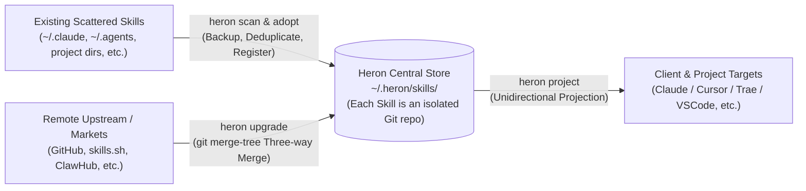
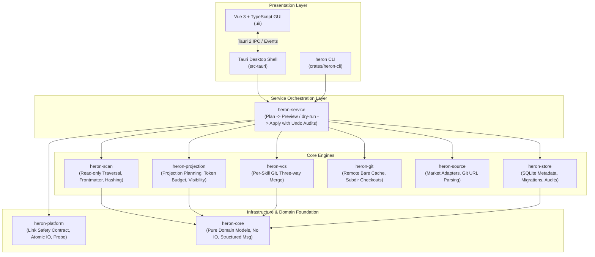

# Heron (苍鹭)

<p align="center">
  
</p>

<p align="center">
  <strong>Gather the Agent Skills scattered across your machine into one versioned, single source of truth, project them where your tools actually look, and make upgrading a single command.</strong>
</p>

<p align="center">
  
  
  
  
  
</p>

<p align="center">
  English · <a href="README.zh-CN.md">中文文档</a>
</p>

---

## Table of Contents

- [Why Heron?](#why-heron)
- [Core Workflow: Adopt · Project · Upgrade](#core-workflow-adopt--project--upgrade)
- [System Architecture & Workspace Crates](#system-architecture--workspace-crates)
- [Core Mechanisms & Technical Highlights](#core-mechanisms--technical-highlights)
  - [1. Single Source of Truth & 4 Projection Modes](#1-single-source-of-truth--4-projection-modes)
  - [2. Per-Skill Git Repositories & Three-Way Merge Upgrades](#2-per-skill-git-repositories--three-way-merge-upgrades)
  - [3. Dynamic Presence Detection for 12+ AI Clients](#3-dynamic-presence-detection-for-12-ai-clients)
  - [4. Team Collaboration & Lockfile](#4-team-collaboration--lockfile)
- [Quick Start](#quick-start)
  - [Requirements](#requirements)
  - [Install](#install)
  - [Three Commands to Get Going](#three-commands-to-get-going)
- [Desktop App Navigation](#desktop-app-navigation)
- [CLI Command Overview](#cli-command-overview)
- [Design Principles & Safety Contracts](#design-principles--safety-contracts)
- [Where Data Lives & Storage Isolation](#where-data-lives--storage-isolation)
- [Development & Contributing](#development--contributing)
  - [Local Development](#local-development)
  - [Debugging Cheat Sheet](#debugging-cheat-sheet)
  - [Building from Source](#building-from-source)
- [Documentation & References](#documentation--references)
- [License](#license)

---

## Why Heron?

Built for developers concurrently running multiple AI coding tools—such as **Claude Code, Codex, Cursor, Trae, Cline, Google Antigravity, OpenCode, and WorkBuddy**.

As Agent Skills (`SKILL.md` bundles containing prompts, execution workflows, scripts, and references) become core engineering assets, their storage and delivery models remain stuck in the stone age: manually copying and pasting folders into hidden system directories. This creates systematic friction:

| Problem Scenario | Traditional Workaround | What Heron Does |
|---|---|---|
| **Scattered**: Skills end up in various global and project directories | Hop across four or five hidden folders to inspect files | `heron scan` inspects everything at once, cleanly distinguishing "managed" vs "unowned" |
| **Duplicated**: The same skill is copied into multiple locations | Edit one copy, and the rest silently drift and become stale | `heron adopt` consolidates copies into **one single entity**, replacing originals with managed links |
| **Opaque Visibility**: No idea whether the client actually loads it | Guesswork debugging; often broken by symlink faults or name shadowing | `heron verify` strictly audits visibility: *live / not scanned / shadowed / broken* |
| **Disconnected Upstream**: Authors push upstream updates unnoticed | Catching updates is purely accidental | `heron outdated` compares local commits against upstream commits, flagging pending updates |
| **Overwritten Customizations**: Upgrades wipe out local prompt tuning | Re-apply personal tweaks and patches after every upgrade | **Three-way merge (`git merge-tree`)**: Preserves upstream improvements while keeping your local customizations intact |
| **Team Drift**: Teammates work with mismatched skill sets | Ad-hoc chat messaging; new hires lack the required skill assets | `heron.lock` exports a lockfile; one command reproduces identical setups |
| **Fragmented Catalogs**: Siloed marketplaces and install tools | Manual downloads, zip extraction, or single-point shell scripts | `heron install` + unified adapter for 5 built-in marketplaces and any Git repo |

---

## Core Workflow: Adopt · Project · Upgrade

Heron collapses complex skill lifecycle management into a clean, closed loop:



1. **Adopt**: Scans the disk for existing skills, creates safe backups, moves physical files into the central store (`~/.heron/skills/`), deduplicates identical content by hash, and replaces original locations with reverse links;
2. **Project**: Unidirectionally projects skills from the store to selected client paths or workspace projects with granular toggles;
3. **Upgrade**: Checks upstream releases and executes three-way merges in an isolated git tree. If conflicts occur, an interactive visual conflict resolver is surfaced, never dirtying your working tree.

---

## System Architecture & Workspace Crates

Heron follows a strict **unidirectional dependency layered architecture**. The business service layer orchestrates all use cases, while the GUI and CLI share the exact same service core to guarantee 100% behavioral parity:



### Workspace Crate Responsibility Matrix

| Crate | Responsibilities & Technical Highlights | Path |
|---|---|---|
| **`heron-core`** | **Pure Domain Model**: Absolutely no IO, async, or system clock. Defines domain models (`Slug`, `Hash`, `PlatformKind`), policies, and localized structured error codes (`Msg`). | [`crates/heron-core`](crates/heron-core) |
| **`heron-platform`** | **OS Abstraction**: Link safety contract (`link`), atomic file mutations, cross-platform locking, process probing (deadline-bound `which` fixing Finder's stripped `PATH`), and automatic proxy detection. | [`crates/heron-platform`](crates/heron-platform) |
| **`heron-store`** | **Metadata Persistence**: Embedded SQLite via `rusqlite`. Manages schemas and tables for clients, targets, skills, projections, source bindings, and historical audit events. | [`crates/heron-store`](crates/heron-store) |
| **`heron-scan`** | **Read-Only Scanner**: Multi-threaded disk traversal, YAML frontmatter parser, Blake3 fingerprinting, streaming progress event emitter, and cooperative cancellation. | [`crates/heron-scan`](crates/heron-scan) |
| **`heron-vcs`** | **Per-Skill Version Control**: Manages independent Git repositories for every skill. Executes in-memory `git merge-tree` three-way merges without touching the working tree. | [`crates/heron-vcs`](crates/heron-vcs) |
| **`heron-git`** | **Remote Git Engine**: Shallow fetching, branch/tag resolution, and local bare Git caching. | [`crates/heron-git`](crates/heron-git) |
| **`heron-source`** | **Marketplace & Source Adapters**: Adapters for 5 major marketplaces (skills.sh, ClawHub, etc.); parses complex Git URLs (repositories, monorepo subdirectories, single-skill files). | [`crates/heron-source`](crates/heron-source) |
| **`heron-projection`**| **Projection & Verification**: Computes projection plans, estimates token budgets, executes safe filesystem linking, and audits live client loading visibility. | [`crates/heron-projection`](crates/heron-projection) |
| **`heron-service`** | **Use Case Orchestrator**: High-level business logic (adopt, project, upgrade, doctor, install, scan). Enforces `Plan -> Preview (dry-run) -> Apply with Undo Audit`. | [`crates/heron-service`](crates/heron-service) |
| **`heron-cli`** | **Unified CLI**: Built on `clap` 4, supporting interactive terminal tables and `--json` machine-readable output. | [`crates/heron-cli`](crates/heron-cli) |
| **`src-tauri`** | **Tauri 2 Shell**: Window management, system tray, IPC routing, and async background scan event streaming (contains zero business logic). | [`src-tauri`](src-tauri) |
| **`ui`** | **Frontend Application**: Vue 3 + TypeScript + Vite + Tailwind CSS + Vue I18n thin client. | [`ui`](ui) |

---

## Core Mechanisms & Technical Highlights

### 1. Single Source of Truth & 4 Projection Modes

The store (`~/.heron/skills/<slug>`) is the single source of truth. To ensure that different AI clients and operating systems can reliably read skills, Heron supports **4 projection modes**:

1. **`symlink` (Symbolic Link)**: Default for macOS and Linux. Zero disk duplication with instant synchronization;
2. **`junction` (Directory Junction)**: Windows-specific. Provides cross-directory links **without requiring Administrator privileges** or Developer Mode;
3. **`pointer` (Pointer File)**: Emits a lightweight proxy `SKILL.md` pointing to the real store path, solving compatibility bugs where certain client scanners report `dirent.isDirectory() == false` on symlinked directories;
4. **`copy` (Unidirectional Copy)**: Fallback mode equipped with drift detection (`E_DRIFTED`), refusing to overwrite unexpected external edits.

### 2. Per-Skill Git Repositories & Three-Way Merge Upgrades

Each adopted skill in the store is initialized as an isolated Git repository:
* **`main` branch**: The user's active working branch (all local custom prompt tweaks are committed here);
* **`upstream` branch**: The mirror of upstream releases (written only during Heron upgrade cycles);
* **`v<version>` tags**: Historical release points allowing one-click rollbacks via `heron rollback`;
* **Three-Way Merge**: Upgrades invoke `git merge-tree --write-tree --merge-base=<baseline>`:
  * **Auto-Merge**: When local changes and upstream improvements do not overlap, they merge cleanly without losing custom lines;
  * **Conflict Protection**: If conflicts occur, the working tree remains untouched. Conflict payloads are parsed and displayed in a side-by-side visual merge editor.

### 3. Dynamic Presence Detection for 12+ AI Clients

Out-of-the-box definitions for 12+ industry AI coding tools:
* **Supported Clients**: Claude Code, Codex, Cursor, Trae, Qoder, Grok, Cline, GitHub Copilot, Google Antigravity, OpenCode, WorkBuddy, Agents, etc.;
* **Non-Invasive Probing**: Probes installation status via compound signals (standard configuration directories, CLI `--version`, and macOS `.app` bundles);
* **Orthogonal State**: Undetected clients are greyed out with an honest "Not detected on this machine" badge, **never deleting configurations and never modifying user-defined `enabled` switches**.

### 4. Team Collaboration & Lockfile

Similar to modern package managers, Heron supports exporting `heron.lock` at the project root:
```bash
heron lock export --write # Export current skill dependencies and commit hashes
heron lock diff           # Detect drifts between local skills and the lockfile
heron lock apply          # Recreate identical skill environments across the team
```

---

## Quick Start

### Requirements

- **git 2.38+** (Required: Three-way merges depend on `git merge-tree --write-tree`);
- **macOS 12+** or **Windows 10 1803+** (Windows requires the built-in WebView2 runtime);
- Linux core is functional; releases currently focus on macOS and Windows packages.

### Install

* **Desktop Application (Recommended)**: Download `Heron.dmg` or `Heron_x64-setup.exe` from Releases;
* **Command Line**: Shipped alongside the desktop app, or downloaded standalone:
  ```bash
  heron --version
  heron --help
  ```

### Three Commands to Get Going

```bash
# 1. Scan known directories and build a global asset index
heron scan

# 2. Inspect skills found on disk that are not managed yet
heron detected

# 3. Adopt all unmanaged skills into the central store (backs up first, deduplicates)
heron adopt --all
```

> [!TIP]
> Before running adopt for the first time, use `--dry-run` to preview all planned mutations:
> `heron adopt --all --dry-run`.

After adoption, original directories remain intact and become links pointing back to the central store:
```text
Before Adoption                               After Adoption
~/.agents/skills/wechat-mp/          →             ~/.agents/skills/wechat-mp   ──┐ (Symlink / Junction)
~/.claude/skills/wechat-mp/          →             ~/.claude/skills/wechat-mp   ──┼─→ ~/.heron/skills/wechat-mp (Single Source of Truth)
/path/to/project/.cursor/wechat-mp/  →             .../project/.cursor/wechat-mp ─┘
```

---

## Desktop App Navigation

The desktop application follows a natural **Adopt → Project → Maintain** layout, featuring automatic theme detection and dark/light toggling:

| View | Purpose |
|---|---|
| **Overview** | **Action Center**: Displays only items requiring active decisions (broken links, merge conflicts, available upgrades, unmanaged skills); displays client presence status. |
| **My Skills** | **Asset Matrix**: One row per skill with client status chips (solid = live, amber = shadowed, red = broken link, hollow = unprojected); drawer enables per-target projection toggling. |
| **Discover** | Browse skills found on disk that are not yet managed; supports selective adoption, dry-run previews, and in-place linking (LiveBind). |
| **Sources & Markets** | 5 integrated marketplaces; supports keyword search, one-click install, direct Git URL installs, and bookmarking. |
| **Upgrades** | Distinguishes between local edits, upstream releases, and diverged conflicts; features an interactive side-by-side file conflict editor. |
| **Health (Doctor)** | Deep read-only diagnostic checks: detects duplicate contents, broken links, pathological directory nestings (e.g. `skills/.claude/skills/`), and missing sources. |
| **Projects** | Discover and manage workspace-specific client configurations and project-scoped skills. |
| **Settings** | Theme preferences, language selection (English / Simplified Chinese), global proxy configuration, and app updates. |

---

## CLI Command Overview

All commands support `--json` (for CI pipelines and scripting) and `--data-dir <DIR>` (for isolated execution):

| Command | Purpose |
|---|---|
| `heron scan [ROOTS...]` | Scan known client paths and optional custom roots to refresh index |
| `heron detected [--state candidate]` | List skills detected on disk that are not yet managed |
| `heron adopt <SLUG...> \| --all` | Safely adopt skills into the store (`--placement replace\|keep\|live-bind`) |
| `heron list` | List all managed skills and their current state |
| `heron project <SLUG> --on <TARGET>` | Project a skill to a target directory (target must be specified) |
| `heron unproject <SLUG> --on <TARGET>` | Retract projection from target (deletes link, preserves store copy) |
| `heron verify` | Audit whether clients will actually load the projected skills |
| `heron doctor` | Run non-destructive system diagnostics |
| `heron install <URL>` | Install skills from GitHub/GitLab, monorepo subpaths, or local directories |
| `heron outdated` | Check managed skills against cached upstream commits |
| `heron upgrade <SLUG...> \| --all` | Upgrade skills via three-way merge |
| `heron rollback <SLUG> --to <TAG>` | Roll back a skill to a specific release tag |
| `heron diff <SLUG>` / `conflict` | View local modifications / inspect pending upgrade conflicts |
| `heron resolve <SLUG>` | Submit resolved conflict files and complete version commits |
| `heron market list \| search \| plan` | Browse and search built-in marketplaces |
| `heron lock export \| diff \| apply` | Export, diff, and apply team lockfiles |
| `heron projects discover [ROOTS...]` | Scan and register projects containing AI tool configurations |

For complete command syntax and parameter details, see the [Command Reference (docs/REFERENCE.md)](docs/REFERENCE.md).

---

## Design Principles & Safety Contracts

> **Heron's Golden Rule: Never silently destroy user data.**

- **Safety Net**: Before mutating or moving existing directories, Heron creates a full backup under `<data-dir>/backups/`; if backup creation fails, the transaction aborts immediately;
- **No Overwrite of Foreign Content**: Projections stop with `E_NOT_MANAGED` when encountering an unmanaged non-empty directory;
- **Drift Protection**: Under `copy` mode, if a target file was modified externally, Heron refuses to overwrite it and reports `E_DRIFTED`;
- **Non-Destructive Doctor**: Diagnostic issues like pathological nesting (`skills/.claude/skills/...`) are reported with recommended remedies, never reorganized silently;
- **Honesty in Capabilities**:
  - Markets are categorized explicitly: direct API installation vs. external browser navigation;
  - Uninstalled client environments are labelled as undetected rather than claiming phantom "active" links;
  - Locally adopted skills without remote tracking are labelled `not tracked` rather than falsely showing as "up-to-date".

---

## Where Data Lives & Storage Isolation

Heron strictly separates the **Single Source of Truth (Store)** from **Runtime Data (Data Directory)**:

| Platform | Runtime Data Directory (backups, logs, cache, `heron.db`) | Central Store (Each skill's Git repo) |
|---|---|---|
| **macOS** | `~/Library/Application Support/xin.v5ai.heron/` | `~/.heron/skills/` |
| **Windows** | `%LOCALAPPDATA%\v5ai\heron\data\` | `%USERPROFILE%\.heron\skills\` |
| **Linux** | `~/.local/share/heron/` | `~/.heron/skills/` |

> [!NOTE]
> `~/.agents/skills` is merely an optional projection target (shared mapping location). It is **not** the Heron store. Heron only manages entries that it created.

---

## Development & Contributing

### Prerequisites

- **Rust**: Stable (pinned via `rust-toolchain.toml`, managed with `rustup`);
- **Node.js**: v22+, with **pnpm** 10+ (`corepack enable`);
- **Git**: 2.38+;
- **Linux Build Dependencies** (not required on macOS / Windows):
  ```bash
  sudo apt install libwebkit2gtk-4.1-dev libgtk-3-dev libayatana-appindicator3-dev librsvg2-dev
  ```

### One-Time Setup

```bash
# 1. Install frontend dependencies
pnpm --dir ui install

# 2. Compile Rust workspace
cargo build --workspace
```

> **Note (Read-only HOME / Sandboxed Environments):** If `~/.cargo` is read-only, point Cargo to a local directory: `export CARGO_HOME=$PWD/.cargo-home`.

### Local Development

```bash
# Start full desktop app (Tauri hot reload, occupies port 5183)
scripts/dev.sh dev

# Frontend-only dev server (Browser opens http://localhost:5183, no Rust IPC)
scripts/dev.sh web

# Run CLI against an isolated test environment (redirects data to /tmp/heron-dev)
scripts/dev.sh cli scan
scripts/dev.sh cli list
```

#### Protecting Your Personal Skills During Dev

```bash
# 1. Isolate the data directory (database, store, and backups redirect together)
./target/debug/heron --data-dir /tmp/heron-dev scan

# 2. Isolate the HOME directory visible to the scanner
HOME=/tmp/fake-home ./target/debug/heron --data-dir /tmp/heron-dev scan
```

### Debugging Cheat Sheet

| Task | Command / Technique |
|---|---|
| **Inspect Backend Logs** | `RUST_LOG=debug cargo run -p heron-app` |
| **Open WebView DevTools** | Right-click in dev window → "Inspect", or press `Cmd+Opt+I` / `Ctrl+Shift+I` |
| **Query Index SQLite Database** | `sqlite3 <data-dir>/heron.db "select * from skill;"` |
| **Inspect Skill Git History** | `git -C ~/.heron/skills/<slug> log --graph --oneline` |
| **Diagnose Inactive Projections** | `heron verify` (inspect not-scanned, shadowed, or broken link causes) |
| **Inspect Upgrade Conflicts** | `heron conflict <slug> --json` |
| **Run Specific Integration Test** | `cargo test -p heron-service --test adopt_flow -- --nocapture` |

### Pre-Push Quality Checks

```bash
scripts/dev.sh check    # fmt + clippy (matches CI rules)
scripts/dev.sh test     # run all unit and integration tests
scripts/dev.sh ui       # TypeScript typecheck, i18n key synchronization & build
```

### Building from Source

```bash
pnpm --dir ui build
cargo build -p heron-cli --release   # CLI binary → target/release/heron
cargo build -p heron-app --release   # Desktop binary
scripts/dev.sh bundle                # Native installer packages (.dmg / NSIS installer)
```

---

## Documentation & References

- **[Getting Started Guide (docs/GUIDE.md)](docs/GUIDE.md)** —— Step-by-step tutorial from chaos to order
- **[Design Document v2 (docs/DESIGN-heron-v2.md)](docs/DESIGN-heron-v2.md)** —— Architectural decisions and background rationale
- **[Implementation Document v1 (docs/IMPLEMENTATION-heron-v1.md)](docs/IMPLEMENTATION-heron-v1.md)** —— Component decomposition and milestones
- **[Command & Error Reference (docs/REFERENCE.md)](docs/REFERENCE.md)** —— Complete CLI manual and structured error codes
- **[Architecture Decision Records (docs/adr/)](docs/adr/)** —— ADR records for platform edge cases and design trade-offs

---

## License

This project is licensed under the [MIT License](LICENSE).
