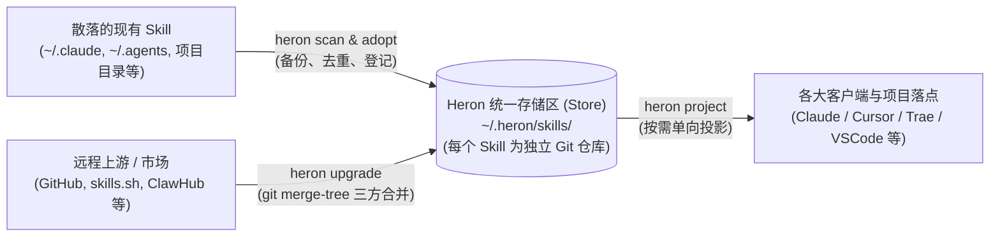
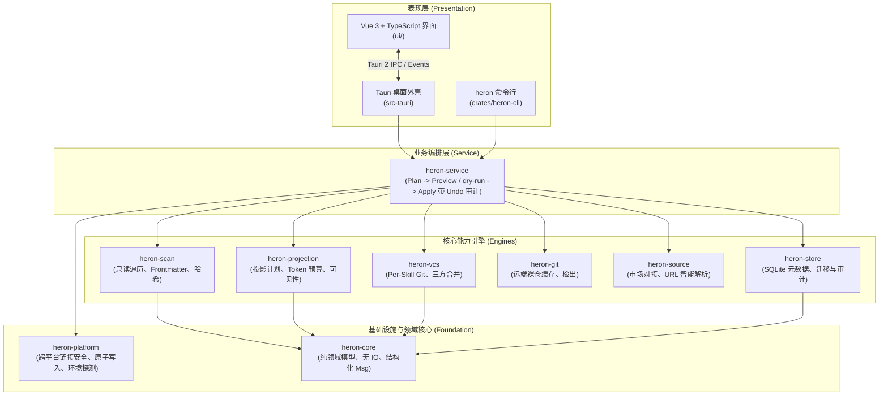

# 苍鹭 Heron

<p align="center">
  
</p>

<p align="center">
  <strong>把散落在各处的 Agent Skill 收拢成一份受版本管理的单一真实源，再按需分发，让升级变成一条命令。</strong>
</p>

<p align="center">
  
  
  
  
  
</p>

<p align="center">
  中文文档 · <a href="README.md">English</a>
</p>

---

## 目录

- [为什么需要 Heron](#为什么需要-heron)
- [核心工作流：收拢 · 分发 · 升级](#核心工作流收拢--分发--升级)
- [系统架构与模块设计](#系统架构与模块设计)
- [核心机制与技术亮点](#核心机制与技术亮点)
  - [1. 单一真实源与 4 种投影模式](#1-单一真实源与-4-种投影模式)
  - [2. Per-Skill Git 仓库与三方合并升级](#2-per-skill-git-仓库与三方合并升级)
  - [3. 12+ AI 客户端动态感知](#3-12-ai-客户端动态感知)
  - [4. 团队协同与锁文件](#4-团队协同与锁文件)
- [快速开始](#快速开始)
  - [环境要求](#环境要求)
  - [安装与初始化](#安装与初始化)
  - [极速三步走](#极速三步走)
- [图形界面导航](#图形界面导航)
- [CLI 命令总览](#cli-命令总览)
- [设计原则与安全契约](#设计原则与安全契约)
- [存储路径与数据隔离](#存储路径与数据隔离)
- [开发与参与贡献](#开发与参与贡献)
  - [本地调试](#本地调试)
  - [调试手段速查](#调试手段速查)
  - [从源码构建打包](#从源码构建打包)
- [文档与参考](#文档与参考)
- [许可](#许可)

---

## 为什么需要 Heron

面向同时使用 **Claude Code、Codex、Cursor、Trae、Cline、Antigravity、OpenCode、WorkBuddy** 等多种 AI 工具的开发者：

随着 Agent Skill 成为沉淀工程经验与工作流的核心资产，其**存储与分发形态**依然停留在原始的「手工复制粘贴到隐藏目录」，由此引发了系统性痛点：

| 痛点场景 | 传统做法 | Heron 的解法 |
|---|---|---|
| **散落**：Skill 分散在各工具全局目录与各项目本地目录 | 手动在四五个隐藏目录间跳跃检查 | `heron scan` 一次扫全，清晰标识「已纳管 / 未纳管」 |
| **重复**：同一 Skill 存在多份物理拷贝 | 修改一处，其余副本全部过时 | `heron adopt` 收拢为**一份**实体，原位置替换为受管链接 |
| **生效状态不透明**：不知道客户端到底有没有读到 | 靠猜排错，常因软链或压制失效 | `heron verify` 严格判定：生效中 / 未被扫描 / 被压制 / 坏链 |
| **上游脱节**：作者更新了 GitHub 仓库无感知 | 碰巧看到才手动去拉代码 | `heron outdated` 对比上游提交，标记是否有可用更新 |
| **升级覆盖定制**：本地改过的提示词升级即丢失 | 每次升级都要人工重新打补丁 | **三方合并（Three-way merge）**：保留上游新特性的同时保留本地改动 |
| **团队环境漂移**：项目内各成员使用的 Skill 不一致 | 靠聊天沟通，新人拉代码缺少依赖 | `heron.lock` 统一导出，一行命令精准复现环境 |
| **安装渠道割裂**：各家生态市场互不相通 | 手动下载解压或用各种单点脚本 | `heron install` + 统一对接 5 大内置市场与任意 Git 仓库 |

---

## 核心工作流：收拢 · 分发 · 升级

Heron 将错综复杂的 Skill 生命周期收拢为简洁的闭环：



1. **收拢（Adopt）**：扫描磁盘上所有 Skill，先备份至安全网，物理移入单一真实源 `~/.heron/skills/`，相同内容自动哈希去重，原位置替换为反向链接；
2. **分发（Project）**：从存储区单向投影到指定的客户端目录或项目目录，支持全局开关与精准启用；
3. **升级（Upgrade）**：对比上游版本，在隔离分支上完成三方合并，有冲突在 UI/CLI 呈现可视化对比合并，杜绝覆盖本地定制。

---

## 系统架构与模块设计

Heron 采用严格的**单向依赖多 Crate 分层架构**。业务服务层统一步调，GUI 与 CLI 共用同一套服务内核，保证行为完全同构：



### 工作区模块分工矩阵

| 模块 | 职责与技术特性 | 目录路径 |
|---|---|---|
| **`heron-core`** | **领域模型核心**：严格禁止 IO、异步和系统时钟。定义基础模型（`Slug`, `Hash`, `PlatformKind`）、策略枚举与多语言错误码 `Msg`。 | [`crates/heron-core`](crates/heron-core) |
| **`heron-platform`** | **跨平台操作系统抽象**：链接安全契约（`link`）、原子文件操作、进程探测（带超时的 `which`，补充 Finder 缺失的 PATH）、网络代理自动探测。 | [`crates/heron-platform`](crates/heron-platform) |
| **`heron-store`** | **元数据持久化**：内嵌 SQLite (`rusqlite`)。管理 clients、targets、skills、projections、source_bindings 与审计事件库。 | [`crates/heron-store`](crates/heron-store) |
| **`heron-scan`** | **无副作用扫描器**：多线程遍历磁盘，解析 `SKILL.md` Frontmatter，计算 Blake3 指纹，支持流式进度广播与随时安全取消。 | [`crates/heron-scan`](crates/heron-scan) |
| **`heron-vcs`** | **版本控制内核**：管理 Skill 内部 Git 仓库，实现 `git merge-tree` 内存级三方合并，生成结构化冲突数据。 | [`crates/heron-vcs`](crates/heron-vcs) |
| **`heron-git`** | **远端 Git 引擎**：负责远程仓库 Shallow Clone、分支解析、离线 Git 缓存池维护。 | [`crates/heron-git`](crates/heron-git) |
| **`heron-source`** | **市场与来源适配**：对接 skills.sh、ClawHub 等 5 大市场；解析单 Skill、Monorepo 子目录等多种 Git 链接格式。 | [`crates/heron-source`](crates/heron-source) |
| **`heron-projection`**| **投影规划与验证**：计算投影 Plan、Token 消耗预算评估、跨平台落地以及客户端加载可见性（Visibility）判定。 | [`crates/heron-projection`](crates/heron-projection) |
| **`heron-service`** | **用例编排层**：收拢、投影、升级、体检等用例编排，遵循 `计算计划 -> 确认预览 -> 执行备份与操作`。 | [`crates/heron-service`](crates/heron-service) |
| **`heron-cli`** | **统一命令行工具**：基于 `clap` 4，支持格式化终端输出与 `--json` 机器可读模式。 | [`crates/heron-cli`](crates/heron-cli) |
| **`src-tauri`** | **桌面应用外壳**：基于 Tauri 2，负责窗口管理、系统托盘、IPC 转发与扫描事件流广播（无业务逻辑）。 | [`src-tauri`](src-tauri) |
| **`ui`** | **前端界面**：Vue 3 + TypeScript + Vite + Tailwind CSS + Vue I18n，纯薄客户端设计。 | [`ui`](ui) |

---

## 核心机制与技术亮点

### 1. 单一真实源与 4 种投影模式

存储区（`~/.heron/skills/<slug>`）是唯一的真相源。为了让不同客户端和操作系统都能正确加载，Heron 实现了 **4 种投影模式**：

1. **`symlink`（符号链接）**：macOS / Linux 首选，单点更新，零磁盘占用；
2. **`junction`（目录连接点）**：Windows 平台专属，**无需管理员提权**即可安全穿透跨目录链接；
3. **`pointer`（指针文件）**：生成轻量代理型 `SKILL.md` 指向实际路径，专门解决部分客户端扫描器判定 symlink 为文件的已知缺陷；
4. **`copy`（单向副本）**：兜底模式，内置漂移检测机制（`E_DRIFTED`），绝不静默覆盖外部意外改动。

### 2. Per-Skill Git 仓库与三方合并升级

每个纳管的 Skill 在存储区中都是一个完整的独立 Git 仓库：
* **`main` 分支**：用户当前的工作分支（本地的所有自定义改动提交在此）；
* **`upstream` 分支**：上游发布的最新代码镜像（仅由 Heron 升级流程写入）；
* **`v<version>` 标签**：每一次成功落地的版本快照（随时支持一键回滚 `heron rollback`）；
* **三方合并**：升级时调用 `git merge-tree --write-tree --merge-base=<baseline>`：
  * **自动合并**：本地改动与上游新功能无重叠时，平滑升级，完全不丢定制代码；
  * **冲突保护**：存在冲突时，工作区不受污染，直接生成冲突差异数据，提供桌面端左右并排对比合并界面。

### 3. 12+ AI 客户端动态感知

内置支持 12+ 常见主流客户端的规范落点与配置定义：
* **支持客户端**：Claude Code、Codex、Cursor、Trae、Qoder、Grok、Cline、GitHub Copilot、Google Antigravity、OpenCode、WorkBuddy、Agents 等；
* **非侵入式感知**：扫描时通过复合信号（目录结构、CLI `--version`、macOS `.app` Bundle）诚实探测本机是否安装对应工具；
* **正交设计**：未检测到的客户端只在 UI 上置灰标注「本机未检测到」，**绝不擅自删除配置，绝不改写用户开关**。

### 4. 团队协同与锁文件

类似包管理器的 lockfile，Heron 支持在项目根目录导出 `heron.lock`：
```bash
heron lock export --write # 导出当前环境的 Skill 依赖清单与版本锁
heron lock diff           # 检查本地 Skill 与锁文件之间的漂移
heron lock apply          # 团队新成员一条命令精准同步就位
```

---

## 快速开始

### 环境要求

- **git 2.38+**（核心依赖：三方合并需要 `git merge-tree --write-tree` 支持）；
- **macOS 12+** 或 **Windows 10 1803+**（Windows 需要系统自带的 WebView2 运行时）；
- Linux 内核已支持，首发以 macOS / Windows 为主要打包目标。

### 安装与初始化

* **桌面应用（推荐）**：从 Releases 下载对应平台的 `Heron.dmg` 或 `Heron_x64-setup.exe`；
* **命令行使用**：随桌面应用捆绑安装，也可通过 Release 单独获取 `heron` 可执行文件：
  ```bash
  heron --version
  heron --help
  ```

### 极速三步走

```bash
# 1. 扫描本机已知路径，建立全局资产索引
heron scan

# 2. 查看机器上存在、但尚未纳管的 Skill
heron detected

# 3. 一键将它们收拢进受管存储区（先备份，再去重）
heron adopt --all
```

> [!TIP]
> 第一次执行收拢建议加上 `--dry-run` 预览：
> `heron adopt --all --dry-run`。
> 查看计划确认无误后再执行。

收拢完成后，原有路径保持不变，原地转换为指向单一真实源的受管投影：
```text
收拢前                                       收拢后
~/.agents/skills/pdf/          →             ~/.agents/skills/pdf   ──┐ (符号链接/连接点)
~/.claude/skills/pdf/          →             ~/.claude/skills/pdf   ──┼─→ ~/.heron/skills/pdf (单一真实源)
/path/to/project/.cursor/pdf/  →             .../project/.cursor/pdf ─┘
```

---

## 图形界面导航

桌面界面按照「**收拢 → 分发 → 维护**」自然动线设计，支持系统跟随及一键深/浅色切换：

| 视图 | 核心职责 |
|---|---|
| **概览 (Overview)** | **行动中心**：只展示需要当前做出决定的事项（坏链、待合并冲突、可升级项、未纳管 Skill）；展示各大客户端真实检测状态。 |
| **我的 Skill (Library)** | **资产全景看板**：每个 Skill 一行，各客户端落点以状态灯清晰展示（实心=生效中，橙=被压制，红=坏链，空心=未投影）；侧边抽屉一键开关落点。 |
| **发现 (Discover)** | 展示磁盘上已存在但未接管的 Skill；支持选择性勾选、Dry-Run 变更预览与就地引用（LiveBind）。 |
| **来源与市场 (Sources)** | 内置 5 大生态市场；支持关键词搜索直装、Git 仓库直连安装与收藏夹管理。 |
| **更新 (Upgrades)** | 智能识别本地改动、上游更新与两端重叠冲突；内置可视化逐文件冲突解决编辑器。 |
| **体检 (Doctor)** | 深度只读健康检查：诊断重复内容、坏链、病态嵌套（如 `skills/.claude/skills/`）与来源丢失。 |
| **项目 (Projects)** | 发现并纳管各工作区工程目录中的客户端配置与专用 Skill。 |
| **设置 (Settings)** | 主题外观、界面语言、全局网络代理配置、应用更新。 |

---

## CLI 命令总览

所有命令均支持 `--json`（供流水线与脚本解析）和 `--data-dir <DIR>`（隔离执行）：

| 命令 | 作用 |
|---|---|
| `heron scan [ROOTS...]` | 扫描已知客户端目录与指定路径，刷新资产索引 |
| `heron detected [--state candidate]` | 列出磁盘上发现但尚未纳管的 Skill |
| `heron adopt <SLUG...> \| --all` | 将外部 Skill 安全收拢进 Store（支持 `--placement replace\|keep\|live-bind`） |
| `heron list` | 列出所有已纳入管理的 Skill 及基本状态 |
| `heron project <SLUG> --on <TARGET>` | 将指定 Skill 投影至客户端落点（必须指明落点，绝不隐式猜测） |
| `heron unproject <SLUG> --on <TARGET>` | 从指定落点撤除投影（仅删除链接，保留 Store 真实源） |
| `heron verify` | 深度校验投影有效性（区分生效中、未扫描、被同名压制、坏链） |
| `heron doctor` | 全局只读体检诊断 |
| `heron install <URL>` | 从 GitHub/GitLab 仓库、Monorepo 子目录或本地路径安装 Skill |
| `heron outdated` | 检查各已纳管 Skill 是否有可用的上游更新 |
| `heron upgrade <SLUG...> \| --all` | 基于三方合并执行安全升级 |
| `heron rollback <SLUG> --to <TAG>` | 一键回滚指定 Skill 到历史版本标签 |
| `heron diff <SLUG>` / `conflict` | 查看本地改动对比 / 查看未决的升级合并冲突 |
| `heron resolve <SLUG>` | 提交解决后的合并冲突并完成版本提交 |
| `heron market list \| search \| plan` | 浏览并搜索内置市场资源 |
| `heron lock export \| diff \| apply` | 导出、对比与复现团队协同锁文件 |
| `heron projects discover [ROOTS...]` | 自动扫描并登记含有客户端配置的项目工程 |

完整参数规范请参阅 [命令参考文档 (docs/REFERENCE.md)](docs/REFERENCE.md)。

---

## 设计原则与安全契约

> **Heron 的首要铁律：从不擅自破坏用户的既有数据。**

- **安全备份网**：任何修改或移动操作前，强制将原目录完整备份至 `<数据目录>/backups/`；备份失败则事务立刻终止；
- **拒绝隐式覆盖**：投影遇到未经纳管的非空实体目录时立即停下并报错 `E_NOT_MANAGED`，决不强制替换；
- **漂移防御**：在 Copy 投影模式下，若检测到外部文件被直接篡改，拒绝覆盖并报 `E_DRIFTED`；
- **病态嵌套只诊断不盲动**：针对历史遗留的恶性嵌套目录（如 `skills/.claude/skills/...`），Doctor 仅给出处置建议，决不擅自移动；
- **架构上的诚实**：
  - 市场分级展示：区分「可 API 搜索直装」与「浏览器访问外链」；
  - 客户端探测三态严格区分，未安装的客户端绝不伪造「生效」状态；
  - 本地修改未被跟踪的 Skill 明确标示为 `not tracked`，避免误导升级。

---

## 存储路径与数据隔离

Heron 严格区分**唯一真相源（Store）**与**应用运行时状态（Data Directory）**：

| 平台 | 运行时数据目录（备份、日志、缓存、`heron.db`） | 统一真相源（Store：各 Skill 的 Git 仓库） |
|---|---|---|
| **macOS** | `~/Library/Application Support/xin.v5ai.heron/` | `~/.heron/skills/` |
| **Windows** | `%LOCALAPPDATA%\v5ai\heron\data\` | `%USERPROFILE%\.heron\skills\` |
| **Linux** | `~/.local/share/heron/` | `~/.heron/skills/` |

> [!NOTE]
> `~/.agents/skills` 只是 Heron 的一个可选投影目标（共享映射点），**绝非** Heron 的真实存储区；Heron 绝不会清理非自己纳管的文件。

---

## 开发与参与贡献

### 准备环境

- **Rust**：Stable（`rust-toolchain.toml` 已锁定稳定版本，推荐使用 `rustup`）；
- **Node.js**：v22+，配合 **pnpm** 10+（`corepack enable` 即可获得）；
- **Git**：2.38+；
- **Linux 编译依赖**（macOS / Windows 无需）：
  ```bash
  sudo apt install libwebkit2gtk-4.1-dev libgtk-3-dev libayatana-appindicator3-dev librsvg2-dev
  ```

### 一次性初始化

```bash
# 1. 安装前端依赖
pnpm --dir ui install

# 2. 编译 Rust 工作区
cargo build --workspace
```

> **注意（受限环境/只读 HOME）：** 若 `~/.cargo` 不可写，可在终端先执行 `export CARGO_HOME=$PWD/.cargo-home`。

### 本地调试

```bash
# 启动桌面端（Tauri 前后端热重载，占用 5183 端口）
scripts/dev.sh dev

# 仅调试前端 UI（浏览器打开 http://localhost:5183，无 Rust 后端调用）
scripts/dev.sh web

# 隔离运行 CLI（自动将数据重定向到 /tmp/heron-dev，绝不污染真实家目录）
scripts/dev.sh cli scan
scripts/dev.sh cli list
```

#### 开发时避免触碰个人真实资产

```bash
# 1. 隔离数据目录（数据、索引库、存储区与备份完全重定向）
./target/debug/heron --data-dir /tmp/heron-dev scan

# 2. 隔离扫描器识别的 HOME 目录
HOME=/tmp/fake-home ./target/debug/heron --data-dir /tmp/heron-dev scan
```

### 调试手段速查

| 调试诉求 | 推荐指令 / 检查点 |
|---|---|
| **查看后端详细日志** | `RUST_LOG=debug cargo run -p heron-app` |
| **打开 WebView 审查元素** | 调试窗口右键点击「检查」，或快捷键 `Cmd+Opt+I` / `Ctrl+Shift+I` |
| **直接查询索引库** | `sqlite3 <数据目录>/heron.db "select * from skill;"` |
| **排查 Skill Git 提交树** | `git -C ~/.heron/skills/<slug> log --graph --oneline` |
| **诊断投影失效原因** | `heron verify`（查看未被扫描、被同名压制、坏链具体成因） |
| **排查三方升级冲突详情** | `heron conflict <slug> --json` |
| **运行指定单测** | `cargo test -p heron-service --test adopt_flow -- --nocapture` |

### 提交前质量检查

```bash
scripts/dev.sh check    # 代码格式化与 Clippy 静态检查（与 CI 完全一致）
scripts/dev.sh test     # 运行全部单元测试与集成测试
scripts/dev.sh ui       # 前端 TypeScript 类型检查、i18n 完整性校验与前端构建
```

### 从源码构建打包

```bash
pnpm --dir ui build
cargo build -p heron-cli --release   # 产出 CLI 二进制 → target/release/heron
cargo build -p heron-app --release   # 产出桌面二进制
scripts/dev.sh bundle                # 生成平台原生安装包（.dmg / NSIS 安装器）
```

---

## 文档与参考

- **[上手指南 (docs/GUIDE.md)](docs/GUIDE.md)** —— 从零整理混乱机器的实战教学
- **[设计文档 v2 (docs/DESIGN-heron-v2.md)](docs/DESIGN-heron-v2.md)** —— 深度架构设计思想、权衡与背景
- **[实现文档 v1 (docs/IMPLEMENTATION-heron-v1.md)](docs/IMPLEMENTATION-heron-v1.md)** —— 系统实现拆解与里程碑
- **[命令与错误码参考 (docs/REFERENCE.md)](docs/REFERENCE.md)** —— 完整 CLI 命令规范与结构化错误码
- **[架构决策记录 (docs/adr/)](docs/adr/)** —— 记录开发中踩到的关键平台坑与架构决策

---

## 许可

本项目采用 [MIT 许可证](LICENSE)。
