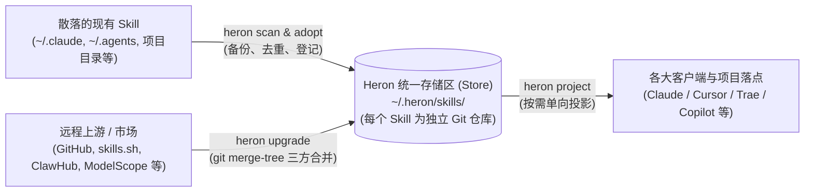
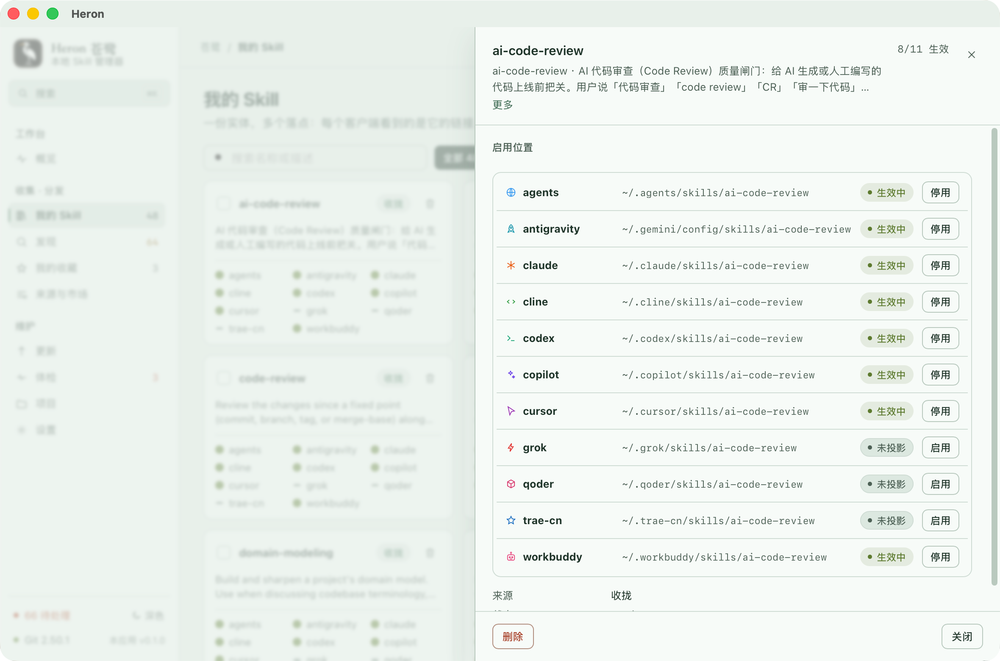
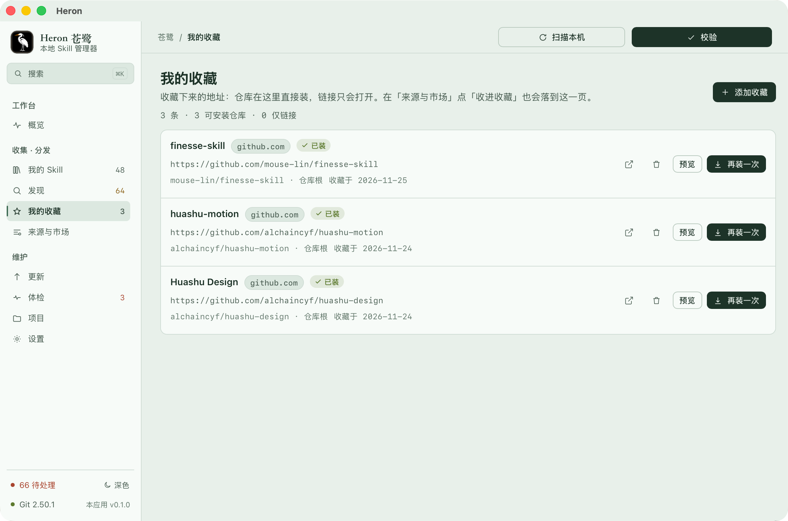
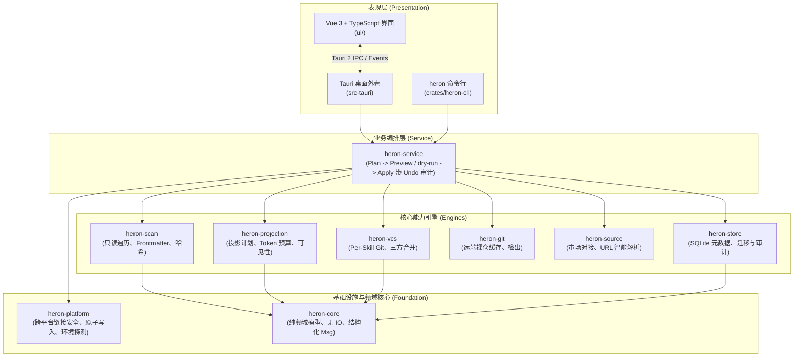

# 苍鹭 Heron

<p align="center">
  
</p>

<p align="center">
  <strong>把散落在各处的 Agent Skill 收拢成一份受版本管理的单一真实源，再按需分发，让升级变成一条命令。</strong>
</p>

<p align="center">
  
  
  
  
  
</p>

<p align="center">
  中文文档 · <a href="README.md">English</a>
</p>

<p align="center">
  <picture>
    <source media="(prefers-color-scheme: dark)" srcset="images/首页-深色.png" />
    <source media="(prefers-color-scheme: light)" srcset="images/首页-浅色.png" />
    
  </picture>
</p>

---

## 目录

- [为什么需要 Heron](#为什么需要-heron)
- [核心工作流：收拢 · 分发 · 升级](#核心工作流收拢--分发--升级)
- [界面预览](#界面预览)
- [系统架构与模块设计](#系统架构与模块设计)
- [核心机制与技术亮点](#核心机制与技术亮点)
  - [1. 单一真实源与 4 种投影模式](#1-单一真实源与-4-种投影模式)
  - [2. Per-Skill Git 仓库与三方合并升级](#2-per-skill-git-仓库与三方合并升级)
  - [3. 13 款 AI 客户端动态感知](#3-13-款-ai-客户端动态感知)
  - [4. 6 大内置市场统一检索与收藏夹](#4-6-大内置市场统一检索与收藏夹)
  - [5. 团队协同与锁文件](#5-团队协同与锁文件)
- [快速开始](#快速开始)
  - [环境要求](#环境要求)
  - [安装与初始化](#安装与初始化)
  - [极速三步走](#极速三步走)
- [图形界面导航](#图形界面导航)
- [CLI 命令总览](#cli-命令总览)
- [设计原则与安全契约](#设计原则与安全契约)
- [存储路径与数据隔离](#存储路径与数据隔离)
- [开发与参与贡献](#开发与参与贡献)
  - [本地调试](#本地调试)
  - [调试手段速查](#调试手段速查)
  - [提交前质量检查](#提交前质量检查)
  - [从源码构建打包](#从源码构建打包)
- [文档与参考](#文档与参考)
- [许可](#许可)

---

## 为什么需要 Heron

面向同时使用 **Claude Code、Codex、Cursor、Trae / Trae CN、Qoder、WorkBuddy、Cline、GitHub Copilot、Grok Build、Antigravity、opencode、`.agents`** 等多种 AI 工具的开发者：

随着 Agent Skill（包含提示词、执行工作流、脚本与参考资料的 `SKILL.md` 目录包）成为沉淀工程经验的核心资产，其**存储与分发形态**依然停留在原始的「手工复制粘贴到隐藏目录」，由此引发了系统性痛点：

| 痛点场景 | 传统做法 | Heron 的解法 |
|---|---|---|
| **散落**：Skill 分散在各工具全局目录与各项目本地目录 | 手动在四五个隐藏目录间跳跃检查 | `heron scan` 一次扫全，清晰标识「已纳管 / 未纳管」 |
| **重复**：同一 Skill 存在多份物理拷贝 | 修改一处，其余副本全部过时 | `heron adopt` 收拢为**一份**实体，原位置替换为受管链接 |
| **生效状态不透明**：不知道客户端到底有没有读到 | 靠猜排错，常因软链或压制失效 | `heron verify` 严格判定：生效中 / 未被扫描 / 被压制 / 需重启 / 坏链 |
| **上游脱节**：作者更新了 GitHub 仓库无感知 | 碰巧看到才手动去拉代码 | `heron outdated` 对比上游提交，标记是否有可用更新 |
| **升级覆盖定制**：本地改过的提示词升级即丢失 | 每次升级都要人工重新打补丁 | **三方合并（`git merge-tree`）**：保留上游新特性的同时保留本地改动 |
| **团队环境漂移**：项目内各成员使用的 Skill 不一致 | 靠聊天沟通，新人拉代码缺少依赖 | `heron.lock` 统一导出（无绝对路径），一行命令精准复现环境 |
| **安装渠道割裂**：各家生态市场互不相通 | 手动下载解压或用各种单点脚本 | `heron install` + 统一对接 **6 大内置市场**、收藏夹与任意 Git 仓库 |

---

## 核心工作流：收拢 · 分发 · 升级

Heron 将错综复杂的 Skill 生命周期收拢为简洁的闭环：



1. **收拢（Adopt）**：扫描磁盘上所有 Skill，先备份至安全网，物理移入单一真实源 `~/.heron/skills/`，相同内容自动哈希去重，原位置替换为反向链接（也支持保留原位置或就地绑定 `live-bind`）；
2. **分发（Project）**：从存储区单向投影到显式指定的客户端目录或项目目录，支持批量投影与逐落点精准开关；
3. **升级（Upgrade）**：对比上游版本，在隔离树上完成三方合并，有冲突在 UI/CLI 呈现可视化逐文件对比合并，绝不污染工作区。

---

## 界面预览

> 截图会自动跟随你的 GitHub 深/浅色主题切换。桌面端内置 **4 套主题**（默认、暮色、林墨、晚晴）、自动/浅色/深色模式，以及全局 `⌘K` / `Ctrl+K` 快捷搜索面板。

| 我的 Skill（网格 / 列表与批量投影） | 单 Skill 逐客户端开关抽屉 |
|---|---|
| <picture><source media="(prefers-color-scheme: dark)" srcset="images/我的Skill-深色.png" /><source media="(prefers-color-scheme: light)" srcset="images/我的Skill-浅色.png" /></picture> | <picture><source media="(prefers-color-scheme: dark)" srcset="images/我的Skill-深色2.png" /><source media="(prefers-color-scheme: light)" srcset="images/我的Skill-浅色2.png" /></picture> |

| 发现（磁盘上未纳管的 Skill） | 来源与市场（多源统一搜索） |
|---|---|
| <picture><source media="(prefers-color-scheme: dark)" srcset="images/发现-深色.png" /><source media="(prefers-color-scheme: light)" srcset="images/发现-浅色.png" /></picture> | <picture><source media="(prefers-color-scheme: dark)" srcset="images/来源与市场-深色.png" /><source media="(prefers-color-scheme: light)" srcset="images/来源与市场-浅色.png" /></picture> |

<details>
<summary><strong>查看更多界面：我的收藏、更新、体检（含安全确认）、设置</strong></summary>

| 我的收藏 | 更新（三方合并升级） |
|---|---|
| <picture><source media="(prefers-color-scheme: dark)" srcset="images/我的收藏-深色.png" /><source media="(prefers-color-scheme: light)" srcset="images/我的收藏-浅色.png" /></picture> | <picture><source media="(prefers-color-scheme: dark)" srcset="images/更新-深色.png" /><source media="(prefers-color-scheme: light)" srcset="images/更新-浅色.png" /></picture> |

| 体检（只读诊断） | 设置（4 套主题、外观与通用配置） |
|---|---|
| <picture><source media="(prefers-color-scheme: dark)" srcset="images/体检-深色.png" /><source media="(prefers-color-scheme: light)" srcset="images/体检-浅色.png" /></picture> | <picture><source media="(prefers-color-scheme: dark)" srcset="images/设置-深色.png" /><source media="(prefers-color-scheme: light)" srcset="images/设置-浅色.png" /></picture> |

</details>

---

## 系统架构与模块设计

Heron 采用严格的**单向依赖多 Crate 分层架构**。业务服务层统一步调，GUI 与 CLI 共用同一套服务内核，保证行为完全同构：



### 工作区模块分工矩阵

| 模块 | 职责与技术特性 | 目录路径 |
|---|---|---|
| **`heron-core`** | **领域模型核心**：严格禁止 IO、异步和系统时钟。定义基础模型（`Slug`, `Hash`, `PlatformKind`）、策略枚举与多语言错误码 `Msg`。 | [`crates/heron-core`](crates/heron-core) |
| **`heron-platform`** | **跨平台操作系统抽象**：链接安全契约（`link`）、原子文件操作、进程探测（带超时的 `which`，补充 Finder 缺失的 PATH）、网络代理自动探测。 | [`crates/heron-platform`](crates/heron-platform) |
| **`heron-store`** | **元数据持久化**：内嵌 SQLite (`rusqlite` bundled)。管理 clients、targets、skills、projections、source_bindings、收藏夹与审计事件库。 | [`crates/heron-store`](crates/heron-store) |
| **`heron-scan`** | **无副作用扫描器**：多线程遍历磁盘（`rayon` + `walkdir`），解析 `SKILL.md` Frontmatter，计算 Blake3 指纹，支持流式进度广播与随时安全取消。 | [`crates/heron-scan`](crates/heron-scan) |
| **`heron-vcs`** | **版本控制内核**：管理 Skill 内部 Git 仓库，实现 `git merge-tree` 内存级三方合并，生成结构化冲突数据。 | [`crates/heron-vcs`](crates/heron-vcs) |
| **`heron-git`** | **远端 Git 引擎**：负责远程仓库 Shallow Clone、分支解析与本地裸仓缓存池维护（`sources-cache`）。 | [`crates/heron-git`](crates/heron-git) |
| **`heron-source`** | **市场与来源适配**：对接 `skills.sh`、`ClawHub`、`Qoder`、`SkillHub`、`ModelScope`、`SkillsMP` 6 大市场；解析单 Skill、Monorepo 子目录、blob 链接、SSH 与本地仓库等多种格式。 | [`crates/heron-source`](crates/heron-source) |
| **`heron-projection`** | **投影规划与验证**：计算投影 Plan、Token 消耗预算评估、跨平台落地以及客户端加载可见性（Visibility）判定。 | [`crates/heron-projection`](crates/heron-projection) |
| **`heron-service`** | **用例编排层**：收拢、投影、升级、体检、锁文件等用例编排，遵循 `计算计划 -> 确认预览 -> 执行备份与操作`。 | [`crates/heron-service`](crates/heron-service) |
| **`heron-cli`** | **统一命令行工具**：基于 `clap` 4，支持格式化终端输出与 `--json` 机器可读模式。 | [`crates/heron-cli`](crates/heron-cli) |
| **`src-tauri`** | **桌面应用外壳**：基于 Tauri 2，负责窗口管理、单实例保护、系统托盘、开机自启、minisign 签名校验自动更新、IPC 转发与扫描事件流广播（无业务逻辑）。 | [`src-tauri`](src-tauri) |
| **`ui`** | **前端界面**：Vue 3 + TypeScript + Vite + Pinia + Vue Router + Vue I18n 纯薄客户端，内置自研设计令牌与 4 套配色主题。 | [`ui`](ui) |

---

## 核心机制与技术亮点

### 1. 单一真实源与 4 种投影模式

存储区（`~/.heron/skills/<slug>`）是唯一的真相源。为了让不同客户端和操作系统都能正确加载，Heron 实现了 **4 种投影模式**：

1. **`symlink`（符号链接）**：macOS / Linux 默认模式，单点更新，零磁盘占用；
2. **`junction`（目录连接点）**：Windows 平台默认模式，**无需管理员提权**即可安全穿透跨目录链接；
3. **`pointer`（指针文件）**：生成轻量代理型 `SKILL.md` 指向实际路径，专门解决部分客户端扫描器只读 `.md` 或判定 symlink 异常的兼容问题；
4. **`copy`（单向副本）**：兜底模式，内置漂移检测机制（`E_DRIFTED`），绝不静默覆盖外部意外改动。

### 2. Per-Skill Git 仓库与三方合并升级

每个纳管的 Skill 在存储区中都是一个完整的独立 Git 仓库：
* **`main` 分支**：用户当前的工作分支（本地的所有自定义改动提交在此）；
* **`upstream` 分支**：上游发布的最新代码镜像（仅由 Heron 升级流程写入）；
* **`v<version>` 标签**：每一次成功落地的版本快照（随时支持一键回滚 `heron rollback`，回滚前自动打 `heron-rollback-backup-*` 保护标签）；
* **三方合并**：升级时调用 `git merge-tree --write-tree --merge-base=<baseline>`：
  * **自动合并**：本地改动与上游新功能无重叠时，平滑升级，完全不丢定制代码；
  * **冲突保护**：存在冲突时，工作区保持原样（退出码 `3`），直接生成冲突差异数据，桌面端提供逐文件左右并排对比合并界面，CLI 可通过 `heron resolve` 处置；
  * **覆盖模式**：若希望直接采用上游快照，可在 CLI 传 `--overwrite` 或在设置中关闭「更新时保留本地改动」。

### 3. 13 款 AI 客户端动态感知

在 [`resources/clients/`](resources/clients) 内置 **13** 款主流客户端的规范落点与能力定义，每条均标注 `verified_by`（`spec` / `doc` / `probe`）：
* **支持客户端**：Claude Code、Codex、Cursor、Trae、Trae CN、Qoder、WorkBuddy、Cline、GitHub Copilot、Grok Build、Antigravity、opencode、Agents（`.agents`）；
* **非侵入式感知**：扫描时通过复合信号（配置目录、CLI 命令、macOS `.app` Bundle）诚实探测本机是否安装对应工具；
* **正交设计**：未检测到的客户端只在 UI 上置灰标注「本机未检测到」，**绝不擅自删除配置，绝不改写用户开关**。

### 4. 6 大内置市场统一检索与收藏夹

Heron 对接 **6** 大 Skill 市场，并诚实分级展示能力：
* **可搜索（Indexed）**：`skills.sh`（命中后直接解析 GitHub 仓库一键安装）、`ClawHub`（REST API 搜索；带上游 Git 地址时直接安装，平台托管条目转为引导页）；
* **仅浏览器引导（Guided）**：`Qoder`、`SkillHub`、`ModelScope`（粘贴魔搭 Skill 页面地址即可直接解析为 Git 克隆安装）、`SkillsMP`（默认关闭）；
* **我的收藏**：支持手工添加 Git 仓库/网页链接或从市场一键收藏，随时预览计划并一键安装。

### 5. 团队协同与锁文件

类似现代包管理器的 lockfile，Heron 支持在项目根目录导出可移植的 `heron.lock`（记录来源、提交、版本与内容哈希，**不记录绝对路径**）：

```bash
heron lock export                       # 在当前目录写出 heron.lock（也支持 --dir <目录> 或 --print）
heron lock diff --file heron.lock       # 检查 Missing / ContentChanged / SourceChanged 漂移
heron lock apply --file heron.lock      # 团队新成员一条命令安装缺失 Skill，复现一致环境
```

---

## 快速开始

### 环境要求

- **git 2.38+**（核心依赖：三方合并需要 `git merge-tree --write-tree` 支持）；
- **macOS 12+** 或 **Windows 10 1803+**（Windows 使用系统自带的 WebView2 运行时）；
- Linux 内核已支持，当前官方发布包以 macOS（Apple Silicon / Intel）与 Windows（x64）为主。

### 安装与初始化

* **桌面应用（推荐）**：从 [Releases](https://github.com/v5note/heron/releases) 下载对应平台的 `Heron_0.1.0_aarch64.dmg`（macOS Apple Silicon）、`Heron_0.1.0_x64.dmg`（macOS Intel）或 `Heron_0.1.0_x64-setup.exe`（Windows x64）。
  * *首次打开说明*：发布包采用 Tauri 内置的 **minisign 更新签名**（未做付费系统级代码签名）。首次启动时，macOS 请右键点击 → 打开，Windows 请点「更多信息」→「仍要运行」；后续应用内自动更新均经过 minisign 公钥验签。详见 [`docs/SIGNING.md`](docs/SIGNING.md)。
* **命令行使用**：可从源码编译或使用独立的 `heron` 可执行文件：
  ```bash
  heron --version
  heron --help
  ```

### 极速三步走

```bash
# 1. 扫描本机已知路径，建立全局资产索引
heron scan

# 2. 查看机器上存在、但尚未纳管的 Skill
heron detected

# 3. 一键将它们收拢进受管存储区（先备份，再去重）
heron adopt --all
```

> [!TIP]
> 第一次执行收拢建议加上 `--dry-run` 预览：
> `heron adopt --all --dry-run`。
> 查看计划确认无误后再执行。

收拢完成后，原有路径保持不变，原地转换为指向单一真实源的受管投影：
```text
收拢前                                       收拢后
~/.agents/skills/wechat-mp/          →             ~/.agents/skills/wechat-mp   ──┐ (符号链接/连接点)
~/.claude/skills/wechat-mp/          →             ~/.claude/skills/wechat-mp   ──┼─→ ~/.heron/skills/wechat-mp (单一真实源)
/path/to/project/.cursor/wechat-mp/  →             .../project/.cursor/wechat-mp ─┘
```

---

## 图形界面导航

桌面界面按「**工作台 → 收集·分发 → 维护**」三段式导航组织，支持全局 `⌘K` / `Ctrl+K` 搜索面板、原生菜单栏（macOS/Linux）、系统托盘与即时主题/语言切换：

| 分组 | 视图 | 核心职责 |
|---|---|---|
| **工作台** | **概览 (Overview)** | **行动中心**：决定队列只展示当前需要你做决定的事项（坏链、冲突、可升级项、未纳管 Skill）；呈现系统读数与各客户端落点直控开关。 |
| **收集 · 分发** | **我的 Skill (My skills)** | **资产全景库**：支持列表/网格双视图、批量勾选投影（`投影到...`）、问题筛选，点击卡片在右侧抽屉逐客户端一键启用/停用。 |
| | **发现 (Discover)** | 展示磁盘上已存在但未接管的 Skill；支持按客户端筛选、选择放置方式（按建议 / 替换 / 保留原位置 / 就地绑定）、预览与批量收拢。 |
| | **我的收藏 (My favourites)** | 收藏 Git 仓库或市场条目，区分可安装仓库 / 仅链接 / 已装状态，支持计划预览与一键安装/重装。 |
| | **来源与市场 (Sources & markets)** | 一个搜索框同时检索 6 大内置市场，实时探测各源延迟、按源分组展示结果，支持直接安装、Git URL 直连与收进收藏。 |
| **维护** | **更新 (Updates)** | 追踪上游提交与本地改动（`已是最新`、`有更新`、`本地已改`、`两端分叉`、`未追踪来源`）；支持批量三方合并与逐文件可视化冲突解决。 |
| | **体检 (Health)** | 只读健康诊断：检测坏链、存储缺失、重复内容、病态嵌套（如 `skills/.claude/skills/`）；任何清理修复操作均需二次确认。 |
| | **项目 (Projects)** | 自动发现并登记工作区工程目录中的客户端 Skill 落点（如 `.claude/skills`、`.cursor/skills`）。 |
| | **设置 (Settings)** | 4 套配色主题（默认 / 暮色 / 林墨 / 晚晴）、自动/浅色/深色模式、中英文切换、默认投影方式、自动扫描/体检开关、合并策略、代理、开机自启、minisign 验签应用更新与客户端能力表。 |

---

## CLI 命令总览

所有命令均支持 `--json`（供流水线与脚本解析）和 `--data-dir <DIR>`（隔离执行）。退出码：`0` 成功 / `1` 一般错误 / `2` 用法错误 / `3` 需要用户决策（如升级冲突）。

| 命令 | 作用 |
|---|---|
| `heron scan [--roots <路径>...] [--max-dirs <n>] [--verbose]` | 扫描已知客户端目录与指定项目根，刷新资产索引 |
| `heron detected [--state <状态>] [--all]` | 列出磁盘上发现但尚未纳管的 Skill（`candidate\|ignored\|adopted\|conflict\|all`） |
| `heron adopt <SLUG\|PATH...> \| --all` | 安全收拢进 Store（支持 `--placement replace\|keep-original\|live-bind`、`--keep-original`、`--dry-run`） |
| `heron list` | 列出所有已纳入管理的 Skill 及来源 |
| `heron targets` | 列出所有已知投影落点 |
| `heron project <SLUG> --on <TARGET> [--mode ...]` | 将 Skill 投影至指定落点（`symlink\|junction\|copy\|pointer`，必须显式指定 `--on`） |
| `heron unproject <SLUG> --on <TARGET>` | 从指定落点撤除投影（仅删除链接，保留 Store 真实源） |
| `heron verify [<SLUG>]` | 深度校验投影有效性（生效中 / 未被扫描 / 被压制 / 需重启 / 坏链） |
| `heron doctor` | 全局只读体检诊断 |
| `heron install <输入> [--ref ...] [--subpath ...] [--as ...]` | 从 GitHub/GitLab 仓库、Monorepo 子目录、SSH 或本地 Git 仓库安装 Skill |
| `heron outdated` | 检查各已纳管 Skill 是否有可用的上游更新 |
| `heron upgrade [<SLUG>...] [--all] [--overwrite] [--dry-run]` | 基于三方合并执行升级（传 `--overwrite` 可放弃本地改动直接采用上游） |
| `heron rollback <SLUG> --to <版本\|标签>` | 一键回滚指定 Skill 到历史版本标签 |
| `heron diff <SLUG> [--against <标签>]` | 查看本地改动（含未提交修改）或与历史标签对比 |
| `heron conflict <SLUG>` | 查看未决的升级合并冲突文件及两边内容 |
| `heron resolve <SLUG> [--take ours\|theirs]` | 选定冲突侧并重试升级 |
| `heron market list \| search \| plan` | 查看、搜索 6 大内置市场并预览安装计划 |
| `heron lock export \| diff \| apply` | 导出（`--dir`/`--print`）、对比（`--file`）与复现（`--file`）团队协同锁文件 |
| `heron projects [--roots <路径>...] [--register] [--depth <n>]` | 自动扫描并可选登记含有客户端 Skill 目录的项目工程 |

完整参数规范与错误码请参阅 [命令与错误码参考 (docs/REFERENCE.md)](docs/REFERENCE.md)。

---

## 设计原则与安全契约

> **Heron 的首要铁律：从不擅自破坏用户的既有数据。**

- **安全备份网**：任何修改或移动操作前，强制将原目录完整备份至 `<数据目录>/backups/`；备份失败则事务立刻终止；
- **拒绝隐式覆盖**：投影遇到未经纳管的非空实体目录时立即停下并报错 `E_NOT_MANAGED`，绝不强制替换；
- **漂移防御**：在 `copy` 投影模式下，若检测到外部文件被直接篡改，拒绝覆盖并报 `E_DRIFTED`；
- **体检只诊断不盲动**：针对病态嵌套（如 `skills/.claude/skills/...`）或存储目录缺失，Doctor 仅给出处置建议，所有清理动作均需用户显式勾选确认；
- **架构上的诚实**：
  - 市场分级展示：明确区分「可应用内搜索直装」与「浏览器引导」；
  - 客户端探测严格区分真实状态，未安装的客户端绝不伪造「生效」；
  - 本地收拢且无上游追踪的 Skill 明确标示为 `not tracked`，绝不伪造「已是最新」。

---

## 存储路径与数据隔离

Heron 严格区分**唯一真相源（Store）**与**应用运行时状态（Data Directory）**：

| 平台 | 运行时数据目录（`heron.db`、`backups/`、`sources-cache/`、`trash/`、`log/`） | 统一真相源（Store：各 Skill 的 Git 仓库） |
|---|---|---|
| **macOS** | `~/Library/Application Support/xin.v5ai.heron/` | `~/.heron/skills/` |
| **Windows** | `%LOCALAPPDATA%\v5ai\heron\data\` | `%USERPROFILE%\.heron\skills\` |
| **Linux** | `~/.local/share/heron/` | `~/.heron/skills/` |

> [!NOTE]
> - `~/.agents/skills` 只是 Heron 的一个可选投影目标（共享映射点），**绝非** Heron 的真实存储区；Heron 绝不会清理非自己纳管的文件。
> - 使用 `--data-dir <路径>` 时，数据目录整体搬家（含配置、缓存、日志、备份、`heron.db`），存储区也随之变为 `<路径>/.heron/skills/`——测试与便携安装因此完全不会触碰真实的 `~/.heron`。

---

## 开发与参与贡献

### 准备环境

- **Rust**：Stable（`rust-toolchain.toml` 已锁定稳定版本，推荐使用 `rustup`）；
- **Node.js**：v22+，配合 **pnpm** 10+（`corepack enable` 即可获得）；
- **Git**：2.38+；
- **Linux 编译依赖**（macOS / Windows 无需）：
  ```bash
  sudo apt install libwebkit2gtk-4.1-dev libgtk-3-dev libayatana-appindicator3-dev librsvg2-dev
  ```

### 一次性初始化

```bash
# 1. 安装前端依赖
pnpm --dir ui install

# 2. 编译 Rust 工作区
cargo build --workspace
```

> **注意（受限环境/只读 HOME）：** 若 `~/.cargo` 不可写，可在终端先执行 `export CARGO_HOME=$PWD/.cargo-home`。

### 本地调试

```bash
# 启动桌面端（Tauri 前后端热重载，占用 5183 端口）
scripts/dev.sh dev

# 没装 tauri-cli 也能跑：脚本会自行启动 Vite 并执行
# `cargo run -p heron-app`，改完 Rust 需手动重跑

# 5183 被上次残留的 dev server 占用？让脚本替你收割
KILL_STALE_DEV=1 scripts/dev.sh dev

# 仅调试前端 UI（浏览器打开 http://localhost:5183，无 Rust 后端调用）
scripts/dev.sh web

# 隔离运行 CLI（自动将数据重定向到 /tmp/heron-dev，绝不污染真实家目录）
scripts/dev.sh cli scan
scripts/dev.sh cli list
```

Windows 下由 `scripts\dev.ps1` 提供完全等价的入口，并用 `scripts\dev.cmd` 做包装（自动绕过默认执行策略，装有 PowerShell 7 时优先使用）。下列命令按 cmd.exe 写法给出，在 PowerShell 中需加 `.\` 前缀，如 `.\scripts\dev.cmd dev`：

```powershell
# 启动桌面端（Tauri 前后端热重载，占用 5183 端口）
scripts\dev.cmd dev

# 没装 tauri-cli 也会自动降级：脚本自己拉起 Vite 并跑
# `cargo run -p heron-app`，改完 Rust 需手动重跑

# 仅调试前端 UI（浏览器打开 http://localhost:5183，无 Rust 后端调用）
scripts\dev.cmd web

# 隔离运行 CLI（数据目录默认为 %TEMP%\heron-dev）
scripts\dev.cmd cli scan
scripts\dev.cmd cli list

# 自行指定隔离数据目录：运行 CLI 前先设置 HERON_DEV_DATA
$env:HERON_DEV_DATA = 'D:\heron-dev'; .\scripts\dev.cmd cli scan

# 5183 端口被上次残留的 dev server 占用？让脚本代为清理
#   cmd：        set KILL_STALE_DEV=1 && scripts\dev.cmd dev
#   PowerShell： $env:KILL_STALE_DEV = '1'; .\scripts\dev.cmd dev
```

#### 开发时避免触碰个人真实资产

```bash
# 1. 隔离数据目录（数据、索引库、存储区与备份完全重定向）
./target/debug/heron --data-dir /tmp/heron-dev scan

# 2. 隔离扫描器识别的 HOME 目录
HOME=/tmp/fake-home ./target/debug/heron --data-dir /tmp/heron-dev scan
```

### 调试手段速查

| 调试诉求 | 推荐指令 / 检查点 |
|---|---|
| **查看后端详细日志** | `RUST_LOG=debug cargo run -p heron-app` |
| **打开 WebView 审查元素** | 调试窗口右键点击「检查」，或快捷键 `Cmd+Opt+I` / `Ctrl+Shift+I` |
| **直接查询索引库** | `sqlite3 <数据目录>/heron.db "select * from skill;"` |
| **排查 Skill Git 提交树** | `git -C ~/.heron/skills/<slug> log --graph --oneline` |
| **诊断投影失效原因** | `heron verify`（查看未被扫描、被同名压制、坏链具体成因） |
| **排查三方升级冲突详情** | `heron conflict <slug> --json` |
| **运行指定单测** | `cargo test -p heron-service --test adopt_flow -- --nocapture` |

### 提交前质量检查

```bash
scripts/dev.sh check    # 代码格式化与 Clippy 静态检查（与 CI 完全一致）
scripts/dev.sh test     # 运行全部单元测试与集成测试
scripts/dev.sh ui       # 前端 TypeScript 类型检查、i18n 完整性校验、IPC 校验与构建
```

> Windows：`scripts\dev.cmd check` / `test` / `ui` 与上述检查完全等价。

### 从源码构建打包

```bash
pnpm --dir ui build
cargo build -p heron-cli --release   # 产出 CLI 二进制 → target/release/heron
cargo build -p heron-app --release   # 产出桌面二进制
scripts/dev.sh bundle                # 生成平台原生安装包（.dmg / NSIS 安装器）
```

> Windows：`scripts\dev.cmd bundle` 产出 NSIS 安装器（`.exe`），需先安装 `tauri-cli`（`cargo install tauri-cli --version "^2" --locked`）。

---

## 文档与参考

- **[上手指南 (docs/GUIDE.md)](docs/GUIDE.md)** —— 从零整理混乱机器的实战教学
- **[命令与错误码参考 (docs/REFERENCE.md)](docs/REFERENCE.md)** —— 完整 CLI 命令规范与结构化错误码
- **[发布与签名 (docs/SIGNING.md)](docs/SIGNING.md)** —— minisign 更新签名、首次运行放行说明与发布流程
- **[设计文档 v2 (docs/DESIGN-heron-v2.md)](docs/DESIGN-heron-v2.md)** —— 深度架构设计思想、权衡与背景
- **[实现文档 v1 (docs/IMPLEMENTATION-heron-v1.md)](docs/IMPLEMENTATION-heron-v1.md)** —— 系统实现拆解与里程碑
- **[架构决策记录 (docs/adr/)](docs/adr/)** —— 记录开发中踩到的关键平台坑与架构决策

---

## 许可

本项目采用 [MIT 许可证](LICENSE)。
