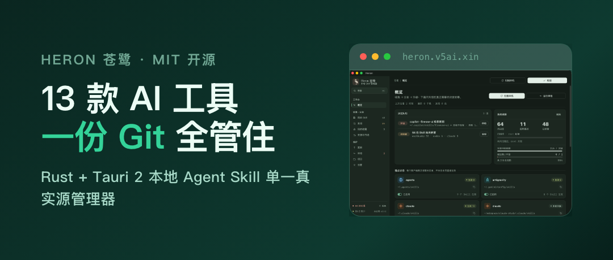
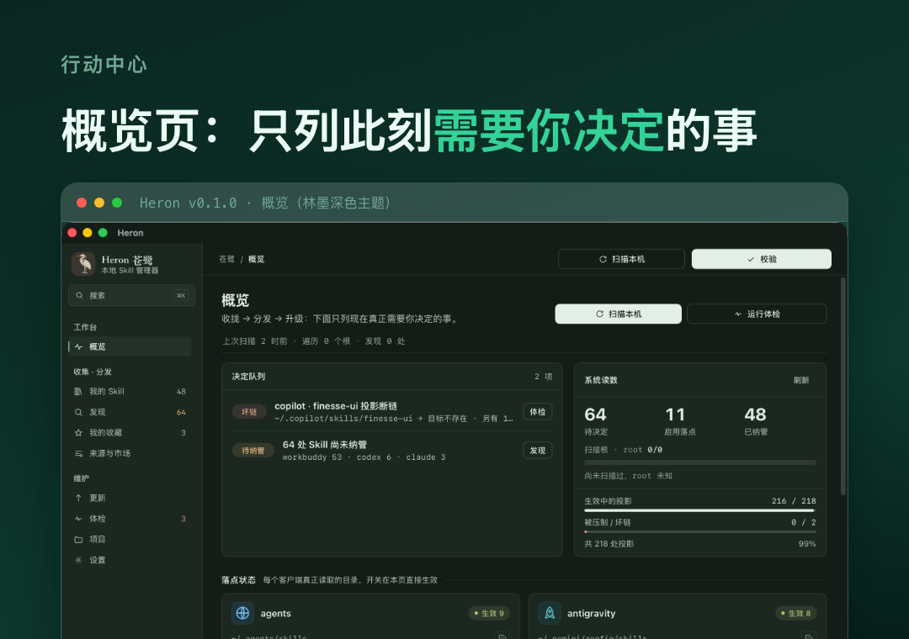
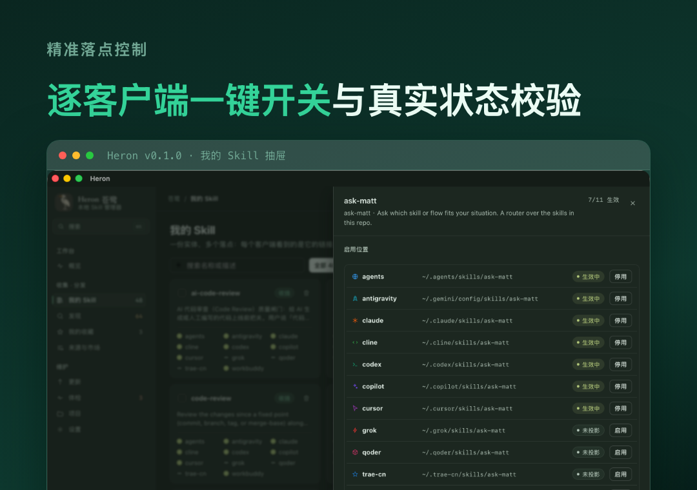
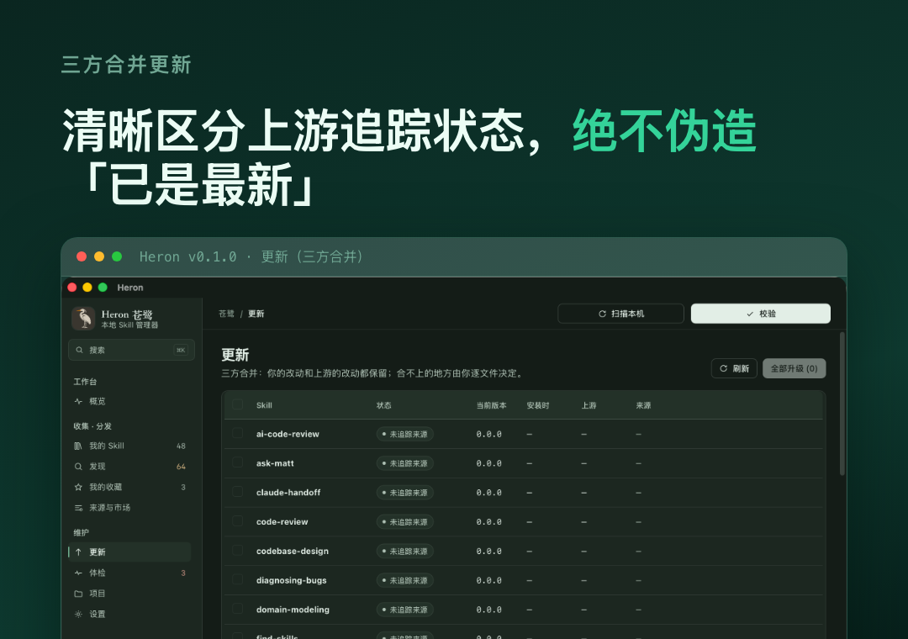
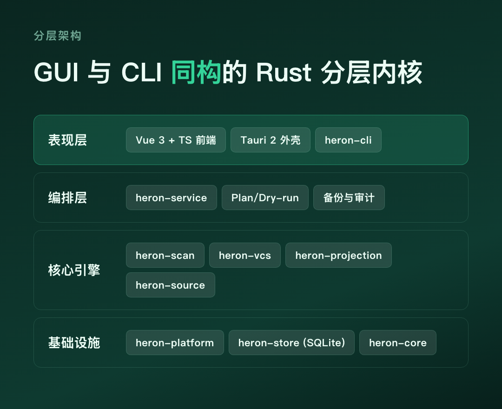

# 开源｜别再手动复制 SKILL.md 了，这款 Rust 工具把 13 款 AI 客户端管明白了

> 摘要：Rust开源Heron苍鹭：单一Git真实源管13款AI的Skill，三方合并升级不丢本地改动。

**本文目录**

- 01 为什么 Agent Skill 需要真正的包管理器
- 02 Heron 是什么：单一真实源与四步闭环
- 03 核心机制拆解：投影、三方合并与诚实探测
- 04 极速上手：桌面端与 CLI 三步跑通
- 05 技术架构与参数一览
- 06 必须说清楚的边界与注意事项

如果你电脑里同时装着 Claude Code、Cursor、Codex、Trae 和 GitHub Copilot，一定经历过这种窒息的瞬间：

好不容易调顺手的一个代码审查 Skill，先复制一份进 `~/.claude/skills/`，再复制一份进 `~/.cursor/skills/`，过两天在项目里微调了几行规则，回头发现另外四个隐藏目录全成了过期副本。

更让人头疼的是上游更新——原作者修了个大 Bug，你一拉代码，自己攒了半个月的本地定制提示词直接被覆盖蒸发。

今天要介绍的开源项目 **Heron（苍鹭）**，就是专门来终结「手工复制粘贴 SKILL.md」的。它用 Rust + Tauri 2 写成，体积只有 5–15 MB，核心思路非常克制：把散落在各处的 Skill 收拢成一份受 Git 版本管理的单一真实源，再按需投影到 13 款 AI 客户端。下面我们拆开看看它的机制、上手方式和真实边界。

## 01 为什么 Agent Skill 需要真正的包管理器

随着 `SKILL.md`（包含提示词、工作流、脚本与参考文档的目录包）成为沉淀工程经验的核心资产，开发者手里的 Skill 数量正迅速从三五个膨胀到几十个。

但行业目前的管理方式依然停留在原始的「手工拷贝到隐藏目录」，由此派生出五个典型痛点：目录散落难盘点、物理副本改一处漏四处、软链失效或被压制全靠猜、上游更新与本地微调二选一、以及团队新人拉下代码后缺少对应 Skill 环境。

Heron 的名字取自「苍鹭静立一处，注视整片水面」。它不试图替你写提示词，也不绑定任何一家 AI 厂商，只专注把 Skill 的「收拢、分发、校验、升级、协同」做成一套确定性的工程闭环。

## 02 Heron 是什么：单一真实源与四步闭环

Heron 的架构底座非常清晰：所有被纳管的 Skill 统一存放在 `~/.heron/skills/<slug>`，这里就是磁盘上唯一的真相源（Store），而且**每个 Skill 目录本身都是一个独立的 Git 仓库**。

围绕这份单一真实源，Heron 跑通了四步闭环：第一步「收拢（Adopt）」，扫描本机各工具目录与项目目录，强制全量备份后按 Blake3 内容哈希去重移入存储区，原位置无缝替换为受管链接；第二步「分发（Project）」，按需单向投影到显式指定的客户端或项目落点；第三步「升级（Upgrade）」，对比上游提交并在内存树上执行三方合并；第四步「协同（Lock）」，导出不含绝对路径的 `heron.lock` 供团队一键复现。

值得一提的是，桌面端（Tauri 2 + Vue 3）和命令行工具（`heron` CLI）共用同一套 Rust 业务编排内核 `heron-service`，任何变更操作都严格遵循「计算计划 → 预览确认（`--dry-run`）→ 备份后执行」的事务顺序。

> 收拢后原有路径保持不变，原地转换为指向唯一真实源的受管投影，绝不破坏既有工程结构。

## 03 核心机制拆解：投影、三方合并与诚实探测

**一、四种投影模式，直面跨平台兼容边界。** 装得上不等于客户端读得到。Heron 在 macOS / Linux 默认使用 `symlink` 符号链接，零磁盘占用且单点修改处处生效；在 Windows 默认使用 `junction` 目录连接点，普通用户无需管理员提权弹窗即可创建；遇到只认实体 `.md` 文件、忽略软链目录的客户端扫描器，可切换 `pointer` 模式生成轻量代理 `SKILL.md`；最后还保留了 `copy` 单向副本兜底，并内置 `E_DRIFTED` 漂移检测，绝不静默覆盖外部手改过的文件。

**二、Per-Skill Git 与三方合并升级。** 每个纳管 Skill 内部维护 `main`（本地工作分支）、`upstream`（上游镜像分支）和 `v<version>` 版本标签。升级时调用 `git merge-tree --write-tree` 在隔离树上完成内存级三方合并：如果上游更新与你的本地提示词微调不冲突，直接平滑合并；一旦有冲突，工作区保持原样不被污染（CLI 退出码 `3`），桌面端弹出逐文件左右对比界面由你裁决。任何时候想反悔，一条 `heron rollback` 即可回到历史版本标签。

**三、13 款 AI 客户端诚实探测与 6 大市场统一检索。** Heron 内置了 Claude Code、Codex、Cursor、Trae、Trae CN、Qoder、WorkBuddy、Cline、GitHub Copilot、Grok Build、Antigravity、opencode 和 `.agents` 共 13 款客户端规范。扫描时结合目录、CLI 命令和 App Bundle 复合信号探测本机安装情况，未安装的客户端只置灰标注，绝不伪造「已生效」。市场方面同样讲诚实：明确区分应用内可直接搜索安装的 `skills.sh`、`ClawHub`，以及浏览器引导的 `Qoder`、`SkillHub`、`ModelScope`、`SkillsMP`。

## 04 极速上手：桌面端与 CLI 三步跑通

你可以直接去 GitHub Releases 或官网下载原生桌面端安装包（macOS Apple Silicon / Intel `.dmg` 或 Windows x64 `.exe`），打开后在「发现」页一键扫描并收拢本机已有 Skill；如果你更习惯终端，命令行三步就能完成初始化：

第一步，执行 `heron scan` 多线程只读扫描本机已知客户端目录与工作区；第二步，执行 `heron detected` 查看磁盘上尚未纳管的 Skill 列表；第三步，先运行 `heron adopt --all --dry-run` 预览收拢与去重计划，确认无误后去掉 `--dry-run` 正式执行。

日常维护同样极简：执行 `heron outdated` 和 `heron upgrade --all` 检查并三方合并上游更新；遇到异常执行 `heron doctor` 做只读体检，定位坏链、重复内容或病态嵌套（例如误操作产生的 `skills/.claude/skills/`）；团队协作时，在仓库根目录运行 `heron lock export` 生成 `heron.lock` 提交到 Git，新成员克隆后一条 `heron lock apply` 即可对齐整套 Skill。

## 05 技术架构与参数一览

Heron 采用严格的单向依赖多 Crate 分层设计：最底层 `heron-core` 禁止任何 IO、异步与系统时钟；中间由 `heron-scan`（rayon + walkdir + Blake3）、`heron-vcs`（git merge-tree）、`heron-projection`、`heron-source` 和内嵌 SQLite 的 `heron-store` 组成能力引擎；顶层 `src-tauri` 与 `heron-cli` 只做薄壳转发。

所有 CLI 命令均支持 `--json` 机器可读输出与 `--data-dir <DIR>` 沙箱目录隔离，方便接入 CI 流水线或便携测试而不触碰真实的 `~/.heron`。

- **维度**：开源协议 / 版本
- **维度**：技术栈与体积
- **维度**：支持平台
- **维度**：内置生态覆盖
- **具体参数与实现**：MIT License · 当前 v0.1.0
- **具体参数与实现**：Rust 1.80+ · Tauri 2 · Vue 3 · 约 5–15 MB 零运行时依赖
- **具体参数与实现**：macOS 12+ (Apple Silicon/Intel)、Windows 10 1803+ (x64)、Linux 源码支持
- **具体参数与实现**：13 款 AI 客户端落点 · 6 大 Skill 市场 · 4 套内置主题

## 06 必须说清楚的边界与注意事项

任何工具都有边界，上手 Heron 前有四件事需要提前了解：

第一，**本机需要 Git 2.38 或更高版本**。因为内存级三方合并依赖 `git merge-tree --write-tree`，老版本 Git 无法运行升级合并流程。

第二，**首次打开未签名安装包需要手动放行**。官方发布包采用 Tauri 内置的 minisign 公钥校验应用内自动更新，但暂未购买商业系统级代码签名证书——首次启动时 macOS 需右键选择「打开」，Windows 需点击「更多信息 → 仍要运行」。

第三，**拒绝静默覆盖是刻意设计**。当投影目标已存在未经纳管的非空目录时，Heron 会直接停下并报 `E_NOT_MANAGED`，需要你先收拢或手动处理，绝不替你删文件。

第四，**如果你只用一款 AI 工具且只有两三个固定 Skill**，手工维护完全够用，没必要引入额外工具；但只要你横跨两款以上 AI 客户端，或者需要和团队统一 Skill 版本，Heron 省下的排错时间会立刻值回票价。

把「散落在隐藏目录里靠记忆维护」变成「一份受 Git 保护、可校验、可回滚、可锁版本的工程资产」，这就是 Heron 苍鹭的价值。项目完全开源免费，值得放进你的 AI 开发工具箱。

---

**官方网站：**https://heron.v5ai.xin
**GitHub 仓库：**https://github.com/v5note/heron
**安装包下载：**https://github.com/v5note/heron/releases

> 觉得实用请点个「赞」和「在看」，转发给同样在用多款 AI 编程工具的同事。
